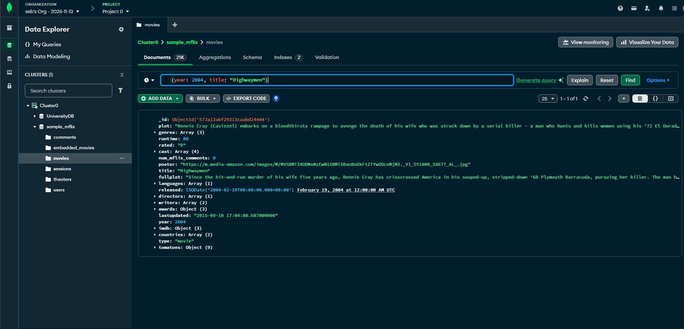

# MongoDB Atlas + PyMongo

Working with a cloud-hosted MongoDB database on **MongoDB Atlas**: CRUD operations in the MongoDB Shell, and a Python app that queries Atlas with **PyMongo**.



## What's here

| Path | Description |
|---|---|
| `movie_lookup.py` | Python CLI that connects to Atlas and looks up a movie in the `sample_mflix` dataset |
| `queries/university_db.js` | mongosh script that creates a `UniversityDB` database and performs insert, find, filter, projection, sort, update and delete operations |

## Tech

- MongoDB Atlas (free M0 cluster)
- Python 3, PyMongo, certifi, dnspython, python-dotenv
- MongoDB Shell (mongosh)

## Setup

```bash
pip install -r requirements.txt
cp .env.example .env   # then add your Atlas connection string
```

Load the **sample_mflix** dataset into your cluster from the Atlas UI (Cluster → ... → Load Sample Data).

## Usage

```bash
python movie_lookup.py                       # default title
python movie_lookup.py "Back to the Future"  # any title
```

Example output:

```
Movie Information
-----------------
Title: Highwaymen

Plot: Rennie Cray (Caviezel) embarks on a bloodthirsty rampage to avenge the death of his wife who was struck down by a serial killer - a man who hunts and kills women using his '72 El Dorado.

Year: 2004
```

### mongosh CRUD script

```bash
mongosh "mongodb+srv://<cluster-host>/" --username <user> --file queries/university_db.js
```

## Notes

Credentials are read from the `MONGODB_URI` environment variable (via `.env`), which is excluded from version control.
